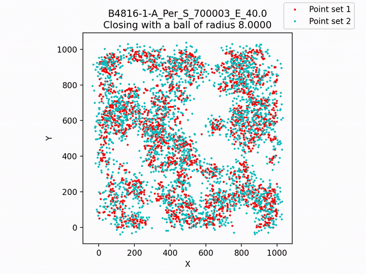

# Multiscale Closing Index (MCI) for measuring structural similarity between 2D point sets

[]({{PAPER_URL}})
[](LICENSE)
[](LICENSE-DATA)
[](requirements.txt)

Nicolò Zava<sup>1</sup>, Ángel Franco-Álvarez<sup>2</sup>, Samy Blusseau<sup>3</sup>, Santiago Velasco-Forero<sup>3</sup>, Maria-Jose Jimenez<sup>2</sup>

<sup>1</sup> Institute of Science and Technology Austria (ISTA)<br>
<sup>2</sup> Universidad de Sevilla<br>
<sup>3</sup> Mines Paris, PSL University, Centre for Statistics and Images (STIM), Fontainebleau, France

{{VENUE}}, 2026

Code and datasets accompanying the paper. The MCI (Multiscale Closing Index) compares two point sets through their morphological closings over a range of radii: for each radius $r$ it measures how much the closings of the two sets differ ($J_\delta$). It ranges from 0 (same point sets) to 1.



*Closings of a B4816 Perlin point set (red) and the same set perturbed with $\varepsilon = 40$ (cyan), for radii 8 to 32 in steps of 4 (MCI = 0.6434). Full video: [`B4816-1-A_Per_S_700003_E_40.0.mp4`](sample_results/05_perturbation_e40/B4816-1-A_Per_S_700003_E_40.0/B4816-1-A_Per_S_700003_E_40.0.mp4); this and nine other cases are in [Sample results](#sample-results).*

## Repository contents

| Folder | Content |
|---|---|
| [`mci_lib/`](mci_lib) | The MCI, the other measurements (Hausdorff distances, Sliced Wasserstein) and the Perlin point set generation |
| [`pipeline/`](pipeline) | Scripts that reproduce the experiments of the paper, step by step, controlled from [`pipeline/config.py`](pipeline/config.py) |
| [`input_datasets/`](input_datasets) | The point sets of the paper, ready to use |
| [`perlin_base_csv_dataset/`](perlin_base_csv_dataset) | Parameters to regenerate every point set from scratch |
| [`results/`](results) | Plots and matrices of the paper results |
| [`sample_results/`](sample_results) | The complete MCI output of 10 dual clouds, one or two of each dataset |
| [`notebook/`](notebook) | Notebook to compute the MCI of your own point clouds |
| [`gradio/`](gradio) | Web viewer to browse MCI results (measurements, plots, frames and videos) |

## Datasets

48 base Perlin point sets in 6 classes of 8 clouds each (S4, S8, S16, B4816, C416-Coarse, C416-Fine), and the dual clouds built from them:

| Dataset | Folder | Dual clouds | Deformation of the second point set |
|---|---|---|---|
| Base | [`input_datasets/base`](input_datasets/base) | 48 | (the base point sets) |
| Cross sets | [`input_datasets/cross`](input_datasets/cross) | 1176 | Another base point set (every pair) |
| Perturbation | [`input_datasets/perturbation`](input_datasets/perturbation) | 240 | Each point moved by up to $\varepsilon$ |
| Removal | [`input_datasets/removal`](input_datasets/removal) | 240 | A % of the points removed |
| Translation and rotation | [`input_datasets/rigid`](input_datasets/rigid) | 432 | Rigid transform |
| Perturbation + removal | [`input_datasets/pert_and_removal`](input_datasets/pert_and_removal) | 1200 | Perturbation $\varepsilon$ and removal combined |
| Impulsive noise | [`input_datasets/impulsive_noise`](input_datasets/impulsive_noise) | 768 | 25 to 100 isolated noise points added |

Each dual cloud is one CSV with the columns `x`, `y` and `Type` (`Type 1` = first point set, `Type 2` = second point set). Every point set can also be regenerated from [`perlin_base_csv_dataset/`](perlin_base_csv_dataset) with the full test of the pipeline, giving the same files.

The datasets are licensed under [CC BY 4.0](LICENSE-DATA): you can reuse them for any purpose, citing the paper.

## Reproducing the paper

```bash
pip install -r requirements.txt
pip install -e .
```

Then choose a dataset in [`pipeline/config.py`](pipeline/config.py) and run steps 3 to 6 of the pipeline. Every step, setting and output is described in **[INSTRUCTIONS.md](INSTRUCTIONS.md)**.

| Dataset (`SELECTED_DATASET_OPTION`) | Result in [`results/`](results) |
|---|---|
| `CROSS` | `Heatmaps Cross Sets/` |
| `PERTURBATION` | `Heatmaps Perturbation/` |
| `REMOVAL` | `Heatmaps Removal/` |
| `TRANSLATION` | `Heatmaps Translation/` |
| `ROTATION` | `Heatmaps Rotation/` |
| `PERT_AND_REMOVAL` | `Heatmaps Pert. and Rem/`, `Grids Pert. and Rem/`, `Compact Pert. and Rem/` |
| `IMPULSIVE_NOISE` | `Bars Impulsive Noise/` |

## Sample results

[`sample_results/`](sample_results) holds the complete MCI output of 10 dual clouds, all built from the same base point set (B4816-1-A), copied from the pipeline runs of the paper. Each folder is exactly what step 5 writes for one dual cloud:

```
<folder>/
├── measurements.csv               (MCI, J_delta per radius, AHD, HD95, Hausdorff and Sliced Wasserstein)
└── <dual cloud>/
    ├── <dual cloud>.mp4           (video of the closings, one frame per radius)
    ├── <dual cloud>_jd_per_r_plot.png   (J_delta per radius)
    └── frames/frame_<i>.png       (one closing per radius)
```

| Folder | Dataset | Dual cloud | Radius | MCI | AHD | HD95 | Hausdorff | Sliced Wasserstein |
|---|---|---|---|---|---|---|---|---|
| [`01_identity`](sample_results/01_identity) | Cross sets | Same point set twice | 8-24 | 0.0000 | 0.00 | 0.00 | 0.00 | 0.00 |
| [`02_cross_same_class`](sample_results/02_cross_same_class) | Cross sets | Two clouds of the same class (B4816) | 8-24 | 0.6073 | 7.50 | 15.26 | 63.70 | 10.77 |
| [`03_cross_other_class`](sample_results/03_cross_other_class) | Cross sets | Clouds of different classes (B4816 vs S4) | 8-24 | 0.8653 | 25.02 | 95.47 | 134.83 | 47.60 |
| [`04_perturbation_e5`](sample_results/04_perturbation_e5) | Perturbation | Perturbation, $\varepsilon$ = 5 | 8-32 | 0.2971 | 4.43 | 5.00 | 5.00 | 1.20 |
| [`05_perturbation_e40`](sample_results/05_perturbation_e40) | Perturbation | Perturbation, $\varepsilon$ = 40 | 8-32 | 0.6434 | 10.86 | 32.05 | 40.00 | 5.23 |
| [`06_removal_20`](sample_results/06_removal_20) | Removal | 20% of the points removed | 12-40 | 0.1399 | 0.86 | 11.19 | 49.65 | 3.98 |
| [`07_translation_10`](sample_results/07_translation_10) | Translation | Translation of 10 px | 8-24 | 0.4757 | 6.88 | 10.00 | 10.00 | 7.04 |
| [`08_rotation_5`](sample_results/08_rotation_5) | Rotation | Rotation of 5 degrees | 8-24 | 0.7096 | 10.63 | 28.23 | 56.15 | 9.05 |
| [`09_pert_and_removal`](sample_results/09_pert_and_removal) | Perturbation + removal | 20% removed and $\varepsilon$ = 20 | 12-48 | 0.3544 | 8.94 | 19.90 | 43.05 | 4.46 |
| [`10_impulsive_noise_100`](sample_results/10_impulsive_noise_100) | Impulsive noise | 100 noise points added | 8-24 | 0.0359 | 0.57 | 0.00 | 78.77 | 2.15 |

The same values are in [`sample_results/summary.csv`](sample_results/summary.csv). Each dataset uses the radius range recommended for its point sets (step 4 of the pipeline), so the MCI is comparable within a dataset, not across datasets with different ranges.

### Browsing the results with Gradio

[`gradio/ps-interface.py`](gradio/ps-interface.py) opens a viewer in the browser to go through MCI results one dual cloud at a time. From the project folder:

```bash
python gradio/ps-interface.py
```

Then open http://127.0.0.1:7860. It starts on `sample_results/`: pick a case in **Select or search a subfolder** to see its MCI, Sliced Wasserstein, AHD, HD95 and Hausdorff, the $J_\delta$ per radius plot, the closing of each radius (the ⯇ ⯈ buttons go through the frames) and the video. To browse a full pipeline run instead, write its MCI folder in **Enter folder path of the data** (for example `runs/261021_MCI_HMAPS_PER/MCI`, as a full path) and press **List Subfolders**. It needs `gradio` from `requirements.txt`; stop it with Ctrl+C.

## MCI of your own point clouds

[`notebook/mci_custom_clouds.ipynb`](notebook/mci_custom_clouds.ipynb) computes the MCI and the other measurements of any pair of point sets (CSV or NumPy), with the same code as the pipeline. See [notebook/README.md](notebook/README.md).

## Citation

If you use this code or the datasets, please cite:

```bibtex
@article{zava2026mci,
  title   = {Multiscale Closing Index (MCI) for measuring structural similarity between 2D point sets},
  author  = {Zava, Nicol{\`o} and Franco-{\'A}lvarez, {\'A}ngel and Blusseau, Samy and Velasco-Forero, Santiago and Jimenez, Maria-Jose},
  journal = { {{VENUE}} },
  year    = { {{YEAR}} },
  doi     = { {{PAPER DOI}} }
}
```

The citation is also in [CITATION.cff](CITATION.cff) (the *Cite this repository* button of GitHub).

## License

- Code: [MIT](LICENSE).
- Datasets (`input_datasets/`, `perlin_base_csv_dataset/`), figures (`results/`, `sample_results/`, and the text and figures of the notebook) and documentation: [CC BY 4.0](LICENSE-DATA).

## Author contributions

Roles following the [CRediT taxonomy](https://credit.niso.org/).

- **Ángel Franco-Álvarez**: software (code of this repository), data curation (generation of the datasets).
- **Nicolò Zava**: {{ROLES}}.
- **Samy Blusseau**: {{ROLES}}.
- **Santiago Velasco-Forero**: {{ROLES}}.
- **Maria-Jose Jimenez**: {{ROLES}}.

## Acknowledgements

This research was partially funded by the French National Research Agency (ANR) under the France 2030 program, grant PR[AI]RIE-PSAI (ANR-23-IACL-0008). 
M.J.J. is supported by grant PID2024-155867NB-I00 funded by MICIU/AEI/10.13039/501100011033 and ERDF/EU and by the IMUS–María de Maeztu grant CEX2024-001517-M (Apoyo a Unidades de Excelencia María de Maeztu), funded by MICIU/AEI/10.13039/501100011033.

### Python libraries

This project builds on several open-source libraries, including
[NumPy](https://numpy.org), [SciPy](https://scipy.org), [pandas](https://pandas.pydata.org),
[Matplotlib](https://matplotlib.org), [seaborn](https://seaborn.pydata.org),
[OpenCV](https://opencv.org), [Shapely](https://shapely.readthedocs.io),
[POT](https://pythonot.github.io), [Gradio](https://gradio.app),
[Jupyter](https://jupyter.org), [IPython](https://ipython.org)
and [perlin-noise](https://pypi.org/project/perlin-noise/).
The versions used for the paper are pinned in [`requirements.txt`](requirements.txt).

## AI Usage disclosure

We have not used AI tools for generating the data, nor for coding the main pipeline and experiments. Claude (Opus 5.5, medium effort) was used for experiment replication testing, code debugging, README generation and proofreading, and for pinning compatible versions in requirements.txt. We have reviewed all AI-assisted work. We take responsibility for the final content of this work, including text, claims or artifacts produced with the aid of generative AI.

## Contact

For any questions related to the code of this repository please mail: afalvarez95@gmail.com.
